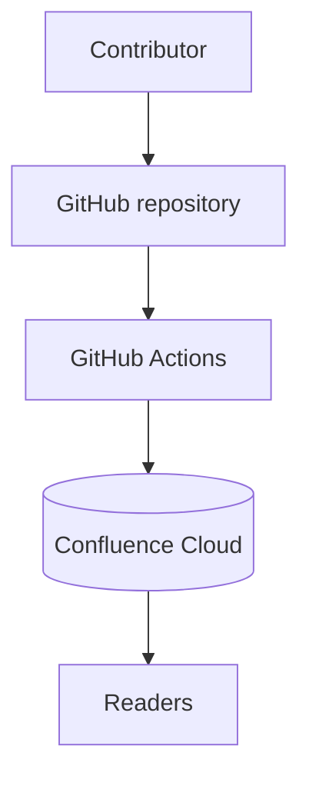

# Architecture Overview

Alpha is a small three-tier system:

## Components

1. **GitHub repository** — stores Markdown, images and Mermaid sources.
2. **GitHub Actions** — renders diagrams and reconciles Confluence.
3. **Confluence Cloud** — read-only publishing destination.

## Identity model

Every document carries a `doc_id` in its front matter. The synchronizer
stores that id as a content property on the Confluence page, so renames and
moves never duplicate pages.

## Image attachment

See also [Alpha Deployment Topology](../policies/deployment.md) or go back to
[Alpha Documentation Home](../index.md).
