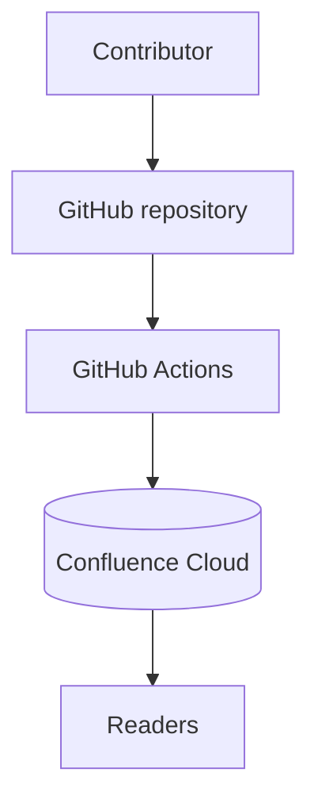

# Architecture Overview

Alpha is a small three-tier system:

## Components

1. **GitHub repository** — stores Markdown, images and Mermaid sources.
2. **GitHub Actions** — renders diagrams and reconciles Confluence.
3. **Confluence Cloud** — read-only publishing destination.

## Identity model

Pages are published by [mark](https://github.com/kovetskiy/mark), which
matches pages by title in the space and remembers which file published each
page in a manifest stored in Confluence (`--track-pages`), so file renames
and retitles update the existing page instead of creating duplicates.

## Image attachment

See also [Alpha Deployment Topology](../policies/deployment.md) or go back to
[Alpha Documentation Home](../index.md).
