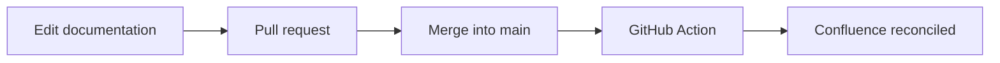

# Welcome to the Alpha documentation

This documentation set is published to Confluence automatically by a GitHub
Action. **GitHub is the source of truth**; Confluence is a read-only mirror.

The publication flow looks like this:

## Where to go next

- The [Alpha User Guide](guide.md) explains day-to-day usage.
- The [architecture overview](architecture/overview.md) describes the system.
- Deployment options are covered in [Alpha Deployment Topology](policies/deployment.md).
- See the [retention policy](policies/retention.md) for data lifetimes.

## Example image

## External resources

- [Confluence Cloud REST API reference](https://developer.atlassian.com/cloud/confluence/rest/intro/)
- [Mermaid diagram syntax](https://mermaid.js.org/syntax/flowchart.html)

## How updates happen

1. Edit or add a Markdown file on a branch.
2. Open a pull request; the validation workflow checks links and diagrams.
3. Merge to `main`.
4. The sync workflow reconciles Confluence — creating, updating, moving, or
   trashing pages as needed.
